# zmk-config — Sweep Bling LP

ZMK config for a Sweep Bling LP (`cradio` shield) on nRF52840 SuperMini controllers
(`nice_nano_v2`). Colemak-DH with Cmd/Opt/Ctrl home row mods, for macOS with the
"British – PC" input source. Ported from the Corne keymap in `../qmk`.

The diagram is redrawn by GitHub Actions on every keymap change
(`.github/workflows/draw-keymaps.yml`), so `git pull` after pushing.

## Using the layers

Thumbs, left to right: **Tab/Nav · Space · Enter/Sym · Backspace**.
Two of them do double duty: **tap** for the key, **hold** for a layer.
Space and Backspace are plain keys, so holding Backspace deletes repeatedly.

| Layer | How to get there | How to leave |
|---|---|---|
| **Nav** (arrows, Home/End, PgUp/PgDn, Delete, Cmd/Opt/Ctrl/Shift, Undo/Cut/Copy/Paste/Redo) | Hold the left outer thumb (tap = Tab) | Release |
| **Sym** (numbers, brackets, UK symbols) | Hold the right inner thumb (tap = Enter) | Release |
| **Fn** (F1–F12, media, volume, brightness, Bluetooth, bootloader) | Hold **both** Nav and Sym, in either order | Release either |
| **Mouse** (move, scroll, click) | In Fn, tap the **G** position. Stays on (toggle) | Tap the **G** position again |

Home row mods: hold **A/R/S** (left) or **E/I/O** (right) for Cmd/Opt/Ctrl. They only
turn into modifiers when the next key is on the other hand, so fast typing stays letters.

### Combos (press both keys together)

| Keys | Result |
|---|---|
| **T + G** or **M + N** (one index finger on both) | Shift. Tap = next key shifted, hold = normal Shift |
| W + F | Esc |
| X + C | Caps Word (caps until the next space) |
| H + , | `_` |
| U + Y | Delete previous word (⌥⌫) |

### Handy Fn keys

| Fn + position of | Does |
|---|---|
| B | Bootloader for the **left** half (flash mode) |
| : (top right) | Bootloader for the **right** half |
| J | Unlock ZMK Studio |
| M / K / , | Bluetooth profile 0 / 1 / 2 |
| / | Clear current Bluetooth pairing |
| O | Switch output USB ↔ Bluetooth |

## Firmware

Pushing builds everything in `build.yaml`; download the `firmware` zip from the
Actions run. Flash by double-tapping reset and copying the `.uf2` onto `NICENANO`.

| File | Use |
|---|---|
| `cradio_left-nice_nano_v2-zmk.uf2` | Left half (central, has ZMK Studio) |
| `cradio_right-nice_nano_v2-zmk.uf2` | Right half |
| `cradio_right_standalone_test.uf2` | Right half as its own keyboard, for testing |
| `cradio_right_standalone_logging.uf2` | Same, with a USB serial log |
| `settings_reset-nice_nano_v2-zmk.uf2` | Clears Bluetooth pairings |

Key bindings can also be changed live with [ZMK Studio](https://zmk.studio)
(unlock with Fn → Studio Unlock). Combos and home-row-mod timing need a rebuild.
